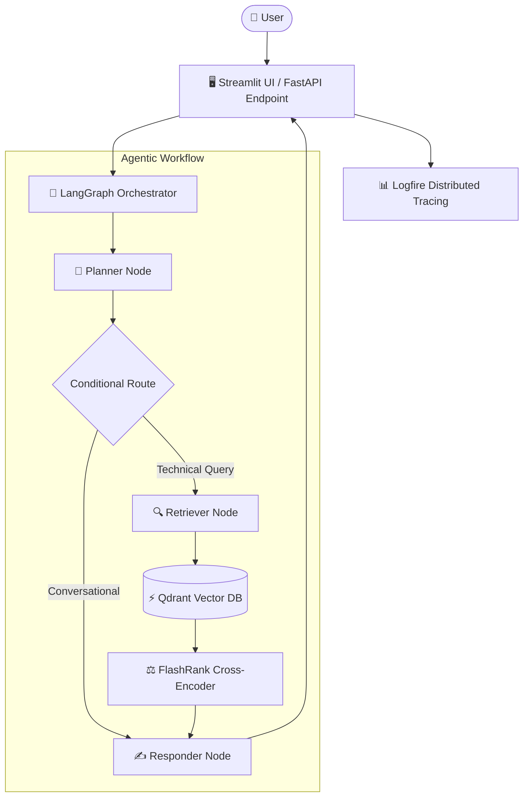

# 🤖 Enterprise Agentic RAG System

An enterprise-grade, agentic Retrieval-Augmented Generation (RAG) platform built with **LangGraph**, **FastAPI**, **Qdrant Vector Database**, **FlashRank Reranking**, **Streamlit**, and **Logfire**.

Designed to seamlessly ingest multi-format corporate documentation (PDF, PPTX, DOCX, HTML, TXT), perform high-precision hybrid retrieval with cross-encoder reranking, and maintain multi-turn conversational context.

---

## 🌟 Key Features

* **🧠 Agentic Workflow (LangGraph)**: Stateful graph execution with dynamic query routing, distinguishing conversational queries from technical search requests.
* **💾 Multi-Turn Session Memory**: Implements `MemorySaver` checkpointer keyed by `thread_id` / session ID for contextual conversations.
* **🔍 Hybrid Retrieval & Reranking**:
  * **Vector Search**: Qdrant Vector Database (`query_points` API).
  * **Semantic Reranking**: FlashRank ONNX Cross-Encoder (`ms-marco-MiniLM-L-6-v2`) for precision score ordering.
* **⚡ Embedding Pipeline with Auto-Fallback**:
  * Primary: Google Gemini Embeddings (`models/gemini-embedding-2-preview`, 3072 dimensions) with exponential backoff retry.
  * Fallback: Local `sentence-transformers` (`all-mpnet-base-v2`, 768 dimensions).
* **📄 Universal Document Ingestion**: Parses, chunks, embeds, and indexes PDFs (`pdfplumber` / `pypdf`), Office files (`docx`, `pptx`), HTML, and plain text.
* **📊 Observability & Distributed Tracing**: Native Logfire integration across API endpoints, agent nodes, and vector database operations.
* **🖥️ Dual Interfaces**:
  * **REST API**: Production FastAPI backend.
  * **User Interface**: Streamlit application featuring live reasoning steps, memory clearance, and source previewing.

---

## 🏗️ Architecture Overview



---

## 📂 Project Structure

```text
Advance-RAG/
├── app/
│   ├── agents/
│   │   ├── nodes/
│   │   │   ├── planner.py       # Query intent analysis & routing logic
│   │   │   ├── retriever.py     # Qdrant search & FlashRank reranking
│   │   │   └── responder.py     # LLM synthesis with context & memory
│   │   ├── graph.py             # LangGraph state machine & memory checkpointer
│   │   └── state.py             # AgentState schema definition
│   ├── ingestion/
│   │   ├── chunking/
│   │   │   └── splitters.py     # Recursive text splitter logic
│   │   ├── loaders/             # Parsers for PDF, HTML, Office & Text
│   │   └── processor.py         # Batch file/directory ingestion engine
│   ├── services/
│   │   └── retrieval/
│   │       ├── embeddings.py    # Gemini & SentenceTransformer embedding service
│   │       ├── qdrant_service.py# Qdrant vector database interface
│   │       └── ranking_service.py# FlashRank semantic reranker service
│   ├── config.py                # Environment configuration loader
│   └── main.py                  # FastAPI application server
├── ui/
│   └── app.py                   # Streamlit web application frontend
├── DATA/                        # Raw document ingestion folder
├── processed_data/              # Local storage for extracted document metadata
├── .env.example                 # Environment variable template
├── requirements.txt             # Python dependency manifest
└── README.md                    # Project documentation
```

---

## 🚀 Getting Started

### 1. Prerequisites
* Python 3.10+
* Qdrant Cloud Cluster endpoint & API Key (or local Qdrant instance)
* API keys for Groq, Gemini, and Logfire

### 2. Installation

Clone the repository and install the dependencies:

```bash
# Clone repository
git clone https://github.com/akaniitesh/Enterprise-Grade-Advanced-RAG.git
cd Enterprise-Grade-Advanced-RAG

# Create virtual environment
python -m venv .venv
source .venv/bin/activate  # On Windows: .venv\Scripts\activate

# Install dependencies
pip install -r requirements.txt
```

### 3. Environment Setup

Create a `.env` file in the root directory matching your credentials:

```env
# Qdrant Vector DB
QDRANT_API_KEY=your_qdrant_api_key
QDRANT_CLUSTER_ENDPOINT=https://your-cluster-endpoint.aws.cloud.qdrant.io

# LLM Providers
GROQ_API_KEY=gsk_your_groq_api_key
GEMINI_API_KEY=your_gemini_api_key

# Observability (Optional)
LOGFIRE_TOKEN=your_logfire_token

# Application Config (Optional)
BACKEND_URL=http://localhost:8000
```

---

## 📥 Ingestion Pipeline

To process and index documents into Qdrant:

1. Place your documents into the `DATA/` directory (supported: `.pdf`, `.html`, `.txt`, `.docx`, `.pptx`).
2. Execute the ingestion script:

```bash
# Ingest all files in DATA/
python -m app.ingestion.processor DATA

# Optional: Wipe collection before ingesting new documents
python -m app.ingestion.processor DATA --wipe
```

---

## 🏃 Running the Application

### 1. Start FastAPI Backend

```bash
uvicorn app.main:app --reload --host 0.0.0.0 --port 8000
```

* API Docs will be available at: `http://localhost:8000/docs`
* Graph Visualization endpoint: `http://localhost:8000/graph`

### 2. Start Streamlit Frontend

In a separate terminal window:

```bash
streamlit run ui/app.py
```

* Streamlit Interface will open at: `http://localhost:8501`

---

## 🌐 API Reference

### `GET /`
Health check endpoint.

### `GET /graph`
Returns a PNG image diagram of the active LangGraph workflow.

### `POST /query`
Processes user questions through the RAG workflow.

**Request Body:**
```json
{
  "q": "What is the recommended setup for Kubernetes network policies?",
  "thread_id": "session_12345"
}
```

**Response:**
```json
{
  "question": "What is the recommended setup for Kubernetes network policies?",
  "answer": "Based on the technical documentation...",
  "thought_process": [
    "Intent: Technical",
    "Search Term: Kubernetes network policies",
    "Context Retrieved",
    "Response Generated"
  ],
  "status": "Response generated successfully.",
  "sources": [
    "CONTENT: ..."
  ]
}
```

---

## 📝 License

Distributed under the MIT License. See `LICENSE` for more information.
